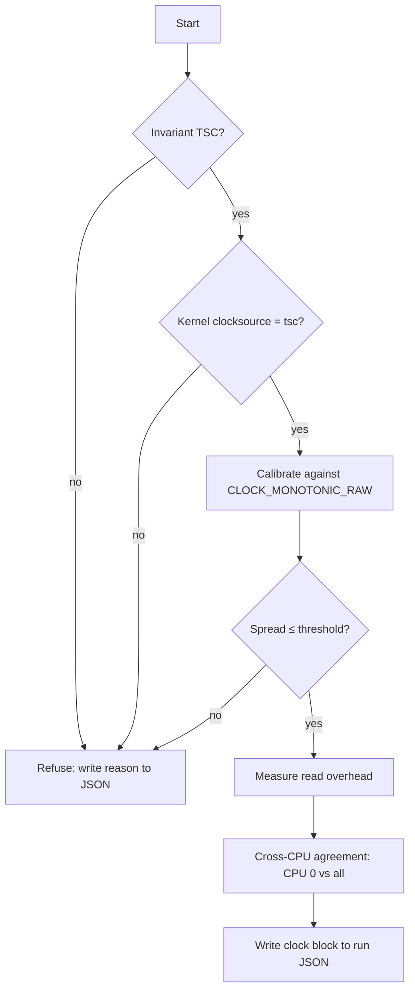

# 001 — Clock

**Status:** Agreed · **Updated:** 2026-10-18

## Proposal

Every latency figure in this repo is a difference between two clock reads. If the clock is wrong,
slow or disagrees between cores, every number built on it is wrong too, and nobody can tell. This
component makes the clock trustworthy and proves it in every run's output.

It does:

- read the TSC with correct ordering, with a start read and an end read;
- refuse to run unless the TSC is invariant and the kernel trusts it;
- calibrate ticks to nanoseconds against `CLOCK_MONOTONIC_RAW`;
- measure and publish its own overhead;
- measure and publish how far TSCs on different CPUs disagree.

It does not:

- provide wall-clock time, PTP or NIC hardware timestamps (depth tier);
- subtract its own overhead from results (overhead is published alongside instead);
- count core cycles (the TSC runs at a fixed rate whatever the core frequency; core cycles come
  from `perf` when needed);
- measure on ARM. It compiles there with a `std::chrono::steady_clock` fallback so the ARM
  correctness tests can build, and refuses to produce published measurements.

## Design

**Reads.** Raw ticks only on the hot path. Conversion to nanoseconds happens at report time.

| Read | Sequence | Why |
|---|---|---|
| `start()` | `lfence; rdtsc; lfence` | Earlier instructions finish before the read; later ones do not start before it |
| `stop()` | `rdtscp; lfence` | `rdtscp` waits for earlier instructions; the fence stops later ones moving above it |
| `stamp()` | `rdtsc` | For cross-thread timestamps carried in a message, where fences would distort the path being measured |

Intrinsics (`__rdtsc`, `__rdtscp`, `_mm_lfence`), no inline assembly.

**Startup checks.**

1. CPUID leaf `0x80000007`, EDX bit 8 (invariant TSC). Absent: refuse.
2. `/sys/devices/system/clocksource/clocksource0/current_clocksource` is `tsc`. Anything else
   means the kernel found the TSC unreliable: refuse.

**Calibration.** N windows (default 10) of about 100 ms each. In each window read
`CLOCK_MONOTONIC_RAW` and the TSC at both ends and compute ticks per ns. Publish the median and
the spread in ppm. Spread above a threshold (default 10 ppm): refuse.

**Overhead.** 1,000,000 back-to-back `start()`/`stop()` pairs, pinned, after warm-up. Publish
p50, p99, p99.9 and max, in ticks and ns. No dependency on the histogram component: a sorted
array is enough here.

**Cross-CPU agreement.** CPU A and CPU B ping-pong a cache line. A records `tA_send` before
writing; B records `tB_recv` on seeing it, then `tB_send` before replying; A records `tA_recv`.
If B's TSC is offset by θ from A's, then over many round trips

    θ ≤ d1 = min(tB_recv − tA_send)
    θ ≥ −d2 = −min(tA_recv − tB_send)

so θ lies in [−d2, d1]. A negative d1 or d2 is direct proof of disagreement. Run CPU 0 against
every other CPU, covering its hyper-thread sibling, the same socket and the other socket.



**Output.** A `clock` block in each run's JSON:

```json
"clock": {
  "source": "rdtsc",
  "invariant_tsc": true,
  "kernel_clocksource": "tsc",
  "ticks_per_ns": 2.19999,
  "calibration_spread_ppm": 0.8,
  "overhead": { "p50_ns": 0, "p99_ns": 0, "p999_ns": 0, "max_ns": 0 },
  "cross_cpu": [ { "a": 0, "b": 44, "theta_lo_ns": 0, "theta_hi_ns": 0 } ]
}
```

Values shown are placeholders, not results.

## Spec

- S1. A run on a CPU without invariant TSC, or with a kernel clocksource other than `tsc`, exits
  non-zero and writes the reason. No results are produced.
- S2. Calibration spread above threshold exits non-zero.
- S3. Every run's JSON contains the `clock` block with all fields above.
- S4. Read overhead is published as p50/p99/p99.9/max, never as an average.
- S5. Cross-CPU bounds are published for CPU 0 against every other online CPU.
- S6. The hot path stores raw ticks only; no conversion or system call between `start()` and
  `stop()`.
- S7. The code compiles on ARM (`steady_clock` fallback), and the fallback refuses to produce
  published measurements.

## Tasks

- [x] Header `include/lfipc/bench/clock.hpp`: `start()`, `stop()`, `stamp()`
- [x] Startup checks (CPUID, kernel clocksource)
- [ ] Calibration
- [ ] Overhead measurement
- [ ] Cross-CPU agreement test
- [ ] JSON `clock` block
- [ ] Tests for S1–S7, including a forced-refusal test (S1, S7 done)
- [ ] First run on dev-lnx01 under `bench-on`; results reviewed here

## Review

| Date | Stage | Finding |
|---|---|---|
| 2026-10-18 | Draft | Written for review |
| 2026-10-18 | Agreed | Approved by Shep without changes |
