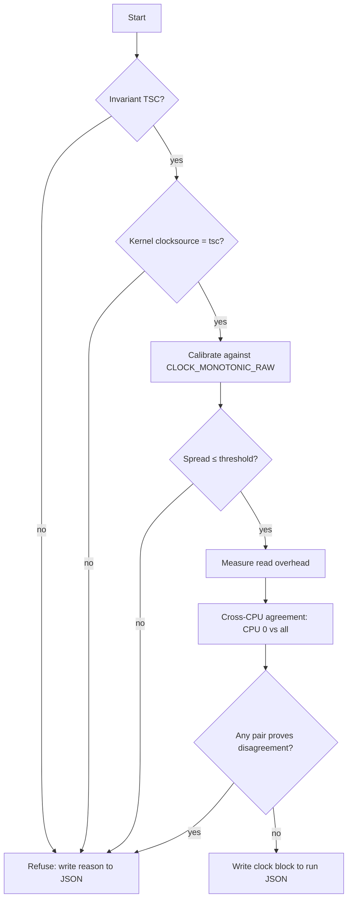

# 001 — Clock

**Status:** Measured · **Updated:** 2026-10-18

## Proposal

Every latency figure in this repo is a difference between two clock reads. If the clock is wrong,
slow or disagrees between cores, every number built on it is wrong too, and nobody can tell. This
component makes the clock trustworthy and proves it in every run's output.

It does:

- read the TSC with correct ordering, with a start read and an end read;
- refuse to run unless the TSC is invariant and the kernel trusts it;
- calibrate ticks to nanoseconds against `CLOCK_MONOTONIC_RAW`;
- measure and publish its own overhead;
- measure and publish how far TSCs on different CPUs disagree.

It does not:

- provide wall-clock time, PTP or NIC hardware timestamps (depth tier);
- subtract its own overhead from results (overhead is published alongside instead);
- count core cycles (the TSC runs at a fixed rate whatever the core frequency; core cycles come
  from `perf` when needed);
- measure on ARM. It compiles there with a `std::chrono::steady_clock` fallback so the ARM
  correctness tests can build, and refuses to produce published measurements.

## Design

**Reads.** Raw ticks only on the hot path. Conversion to nanoseconds happens at report time.

| Read | Sequence | Why |
|---|---|---|
| `start()` | `lfence; rdtsc; lfence` | Earlier instructions finish before the read; later ones do not start before it |
| `stop()` | `rdtscp; lfence` | `rdtscp` waits for earlier instructions; the fence stops later ones moving above it |
| `stamp()` | `rdtsc` | For cross-thread timestamps carried in a message, where fences would distort the path being measured |

Intrinsics (`__rdtsc`, `__rdtscp`, `_mm_lfence`), no inline assembly.

**Startup checks.**

1. CPUID leaf `0x80000007`, EDX bit 8 (invariant TSC). Absent: refuse.
2. `/sys/devices/system/clocksource/clocksource0/current_clocksource` is `tsc`. Anything else
   means the kernel found the TSC unreliable: refuse.

**Calibration.** N windows (default 10) of about 100 ms each. In each window read
`CLOCK_MONOTONIC_RAW` and the TSC at both ends and compute ticks per ns. Publish the median and
the spread in ppm. Spread above a threshold (default 10 ppm): refuse.

**Overhead.** 1,000,000 back-to-back `start()`/`stop()` pairs, pinned to CPU 1, after warm-up.
Not CPU 0: it takes the most housekeeping interrupts, which would inflate the tail. A CPU that
cannot be pinned refuses the run. Publish p50, p99, p99.9 and max in ns; ticks follow from `ticks_per_ns`. No
dependency on the histogram component: a sorted array is enough here.

**Cross-CPU agreement.** CPU A and CPU B ping-pong a cache line. A records `tA_send` before
writing; B records `tB_recv` on seeing it, then `tB_send` before replying; A records `tA_recv`.
If B's TSC is offset by θ from A's, then over many round trips

    θ ≤ d1 = min(tB_recv − tA_send)
    θ ≥ −d2 = −min(tA_recv − tB_send)

so θ lies in [−d2, d1]. A negative d1 or d2 is direct proof of disagreement. Run CPU 0 against
every other CPU, covering its hyper-thread sibling, the same socket and the other socket.

The interval's width, d1 + d2, is the fastest round trip: two one-way cache-line transfers. It
is a property of the interconnect, not of the clocks. Expect tens of ns on one socket and more
across the inter-socket link. The test can therefore prove disagreement (a negative bound), but
it can only show agreement to within that width. The output says so, so that a wide
cross-socket interval is not read as skew.

The reads must be fenced, or the bounds are wrong. An unfenced `rdtsc` can execute early or
late relative to the load or store around it. If B's receive read runs before its load has seen
A's write, or A's send read runs after its store has gone out, d1 shrinks and can go negative on
clocks that agree: a false proof of disagreement. So the send side uses `start()`
(`lfence; rdtsc; lfence`) before the store, and the receive side spins on the load, then
`lfence; rdtsc`. `stamp()` is not used here.

A is CPU 0. It takes housekeeping interrupts, but the bounds are minimums: an interrupted
round trip only produces a larger sample, which the minimum discards.

Each pair runs a fixed number of round trips (default 100,000). The minimum is also taken
separately over the first and second halves. If either bound's second-half minimum is lower
than its first-half minimum by more than 1% of the pair's interval width (d1 + d2), the count
was not enough to converge, and the pair is marked `converged: false`. So `converged` means a
longer run would tighten the interval by less than 1%. A fixed tick tolerance does not work:
under bench-on, minimums settle in steps of 2–4 ticks (Review, 2026-10-18).



**Output.** A `clock` block in each run's JSON, written by `write_clock_block()`, which every
benchmark calls. `bench/clock_bench` runs the flowchart above end to end and writes
`results/clock-<host>-<UTC time>.json`; it is the program for the reviewed run. The JSON is
written by a small hand-written writer (`json.hpp`), not a library: the shape is small and fixed,
and the measurement harness keeps no dependencies. Numbers use `std::to_chars`, so they read back
to the same value; strings are escaped.

```json
"clock": {
  "ok": true,
  "source": "rdtsc",
  "invariant_tsc": true,
  "kernel_clocksource": "tsc",
  "ticks_per_ns": 2.19999,
  "calibration_spread_ppm": 0.8,
  "overhead": { "cpu": 1, "samples": 1000000, "warmup_discarded": 100000,
                "p50_ns": 0, "p99_ns": 0, "p999_ns": 0, "max_ns": 0 },
  "cross_cpu": [ { "a": 0, "b": 44, "theta_lo_ns": 0, "theta_hi_ns": 0,
                  "round_trips": 100000, "warmup_discarded": 1000, "converged": true } ]
}
```

On refusal the block is `ok: false`, a `reason`, and the three check fields (`source`,
`invariant_tsc`, `kernel_clocksource`) only; no results. The program exits non-zero.

Values shown are placeholders, not results.

## Spec

- S1. A run on a CPU without invariant TSC, or with a kernel clocksource other than `tsc`, exits
  non-zero and writes the reason. No results are produced.
- S2. Calibration spread above threshold exits non-zero.
- S3. Every run's JSON contains the `clock` block with all fields above.
- S4. Read overhead is published as p50/p99/p99.9/max, never as an average.
- S5. Cross-CPU bounds are published for CPU 0 against every other online CPU.
- S6. The hot path stores raw ticks only; no conversion or system call between `start()` and
  `stop()`.
- S7. The code compiles on ARM (`steady_clock` fallback), and the fallback refuses to produce
  published measurements.
- S8. Cross-CPU reads are fenced: the send read cannot move after the store, and the receive
  read cannot move before the load that observes the other CPU's write.
- S9. A cross-CPU pair that proves disagreement (a negative bound) refuses the run; the reason
  names the CPUs and the bounds.

## Tasks

- [x] Header `include/lfipc/bench/clock.hpp`: `start()`, `stop()`, `stamp()`
- [x] Startup checks (CPUID, kernel clocksource)
- [x] Calibration
- [x] Overhead measurement
- [x] Cross-CPU agreement test
- [x] Characterise the two-speed cross-socket return transfer (Review, 2026-10-18); root
      cause deferred to the queue work, where cross-socket latency is the measured quantity
- [x] JSON `clock` block: `json.hpp`, `write_clock_block()`, `bench/clock_bench`
- [x] Tests for S1–S9, including a forced-refusal test
- [ ] First run on dev-lnx01 under `bench-on`; results reviewed here

## Review

| Date | Stage | Finding |
|---|---|---|
| 2026-10-18 | Draft | Written for review |
| 2026-10-18 | Agreed | Approved by Shep without changes |
| 2026-10-18 | Built (partial) | Calibration on dev-lnx01: 2.1974531 ticks/ns in three runs, spread 0.03–0.07 ppm. Nominal is 2.2 GHz; assuming it would be 0.12% off. Not yet a bench-on run |
| 2026-10-18 | Built (partial) | Cross-check: kernel refined calibration at boot reports 2197.453 MHz, matching ours to the kHz. Its first quick estimate (2197.632 MHz) was 81 ppm off |
| 2026-10-18 | Built (partial) | Overhead of a start()/stop() pair on dev-lnx01, CPU 2, not bench-on: p50 31–32 ns, p99 47 ns, p99.9 47 ns, max 17–24 µs. The max is about 500× the p50: interruptions, to be explained by the noise-floor meter |
| 2026-10-18 | Built (partial) | The percentile test caught a floating-point bug: 99.9 / 100 × 1000 rounds up past 999, so a bare ceil() reports the wrong rank in the tail. Fixed with p × n first and a guard |
| 2026-10-18 | Agreed | Cross-CPU section: interval width explained as the round-trip floor; reference CPU and round-trip count left as an open question |
| 2026-10-18 | Agreed | Open question settled with Shep: A stays CPU 0; 10,000 round trips per pair with a half-vs-half convergence check; fenced reads required (new S8) |
| 2026-10-18 | Built (partial) | Cross-CPU on dev-lnx01, not bench-on (schedutil; idle cores at 1.2 GHz): 87 pairs in 0.8 s, none proves disagreement. Widths: HT sibling (44) 51 ns, symmetric ±25.5; same socket 150–290 ns; other socket 290–390 ns. Only 21 of 87 converged: minimums fall with count (cross-socket d2 686 → 438 ticks from 10k to 1M round trips) and vary 20–60 ticks run to run. Cause is the target core's frequency ramping during a ~3 ms pair, not the interconnect; the convergence check flagged it as intended. Count and tolerance to be judged under bench-on |
| 2026-10-18 | Built (partial) | Cross-CPU, bench-on run 1: 87 pairs, none proves disagreement. Widths: HT sibling 47 ns (−24 to +23); same socket 177–203 ns; other socket 397–429 ns. Hyper-thread siblings of one core give identical bounds to the tick (1/45, 2/46, 3/47): the minimum is set by the physical core. 51 of 87 converged. Cross-socket widths are wider than without bench-on (290–390 ns); unexplained, possibly less turbo headroom with deep C-states off |
| 2026-10-18 | Built (partial) | Cross-CPU, bench-on run 2, with second-half gain printed: 48 of 87 converged. Gain 0–4 ticks on every same-socket pair; cross-socket mostly ≤ 4, five pairs at 9–18 ticks. The minimums have converged; the one-tick tolerance is below their step size. Tolerance change proposed in Design |
| 2026-10-18 | Built (partial) | Same run: in 17 of 44 cross-socket pairs, d2 (B → A) was 220–280 ticks (≈ 100–125 ns) lower in the first half than the second, giving widths of ≈ 310 ns against ≈ 425 ns. Pairs fall in runs of consecutive CPUs (76–84), so a machine-wide state is changing over tens of ms; absent in run 1. Bounds stay valid (fenced reads cannot make d2 too small), but the cross-socket figure is not reproducible, and the convergence check, which only looks for a lower second half, misses it. Suspect uncore frequency scaling; to check with turbostat (uncore MHz) during a bench-on run |
| 2026-10-18 | Agreed | Convergence tolerance changed to 1% of the interval width, approved by Shep. Same machine, not bench-on, after the change: 48 of 87 converged |
| 2026-10-18 | Built (partial) | Uncore probe (scratch, not committed): 5 sweeps under bench-on with both sockets' uncore frequency sampled every 5 ms. Uncore idles low and takes ≈ 120 ms to ramp from 1.6 to 2.8 GHz; pairs measured during the ramp were ≈ 25% wider (CPU 1: 677 against 537 ticks). bench-on does not control this, and the 1,000-round-trip warm-up (≈ 0.3 ms) does not cover it. Fix: bench-on pins uncore min frequency to 2.8 GHz on both sockets |
| 2026-10-18 | Built (partial) | Two-speed cross-socket effect: with uncore at 2.8 GHz throughout, 0 of 220 cross-socket pairs were fast, so uncore frequency does not cause it. Memory placement does not decide it either: `numactl --membind=0` gave 0 of 44 fast in one run and 30 of 44 in the next. A machine state that comes and goes during a run; coherence directory or snoop state is the likeliest cause (the ≈ 100 ns gap is about one memory access). Bounds are valid in both modes and each run publishes its own, so the clock proceeds. Also explains bench-on run 1's wider cross-socket widths: the earlier run without bench-on contained fast-mode pairs. Decided with Shep: root cause deferred to the queue work |
| 2026-10-18 | Agreed | Output amended, approved by Shep: hand-written JSON writer; `clock_bench` writes the run file; refusal block with `ok` and `reason`; sample counts, warm-up and overhead CPU added to the fields |
| 2026-10-18 | Built (partial) | JSON block built. `clock_bench` on dev-lnx01, not bench-on: 1.8 s, 87 pairs, file parses with exactly the agreed fields (checked by `check_clock_json.py`, S3). Forced refusal writes `ok: false` with the reason and no results (S1). Overhead ran on CPU 62, wherever the process started: the overhead CPU is not controlled |
| 2026-10-18 | Agreed | Approved by Shep: overhead pinned to CPU 1, not CPU 0 (interrupt load inflates the tail; CPU 0 stays the cross-CPU reference, where minimums discard interrupts). Proven disagreement refuses the run (new S9) |
| 2026-10-18 | Built | S6 and S8 checked in the compiled code (`check_hot_path.py`, objdump). S6: every rdtsc → rdtscp window in the real overhead loop holds only `lfence`, `mov`, `shl`, `or` on registers. S8: in both cross-CPU threads every read is fenced before any memory access or branch, and each send read has an lfence directly after it. GCC schedules register-only moves between a fence and its read; harmless, and the rule allows it. Checked against a deliberately broken subject (system call in the window, `stamp()` in the threads): every check fails on it. Overhead wording: ns published, ticks follow from `ticks_per_ns`. All tasks but the reviewed bench-on run are done |
| 2026-10-18 | Built | First reviewed run (bench-on, uncore pinned; not committed, superseded): 13 of 87 pairs not converged at 10,000 round trips. Raised to 100,000, approved by Shep. Same run: overhead on CPU 1 p50 21.4 ns, p99 23.2, p99.9 24.1, max 254 µs (unexplained, for the noise-floor meter); every cross-socket pair in the fast mode (widths 280–339 ns) |
| 2026-10-18 | Built | S7: every target (7 tests and `clock_bench`) compiles for aarch64 with `-Wall -Wextra -Wpedantic -Werror`, aarch64-linux-gnu-g++ 15.2. Not run on ARM (no emulator here); the fallback's refusal is covered by the logic tests. Running on ARM is for the ARM CI |
| 2026-10-18 | Measured | Reviewed run: `results/clock-dev-lnx01-20261018T194404Z.json`. dev-lnx01, bench-on (performance governor, deep C-states off, uncore pinned at 2.8 GHz), `clock_bench` Release build, 100,000 round trips per pair, warm-up 1,000 discarded; overhead 1,000,000 samples, warm-up 100,000 discarded. Calibration 2.1974531 ticks/ns, spread 0.03 ppm. Overhead on CPU 1: p50 21.4 ns, p99 23.2, p99.9 24.1, max 7.3 µs; p50 to p99.9 identical to the previous run, max not (254 µs then). Cross-CPU, 87 pairs, none proves disagreement: HT sibling ±22.8 ns (width 45.5); same socket widths 180–210 ns, all converged; other socket 397–425 ns, 4 not converged (32, 71, 84, 86). Every cross-socket pair was in the slow mode this run and the fast mode in the run before, under the same settings: the two-speed effect is a run-to-run state, and the likely cause of the 4 unconverged pairs. Root cause stays with the queue work. Spec: S1–S6, S8, S9 pass; S7 compiles for aarch64, not run there |
| 2026-10-18 | Measured | Finding from the histogram run (`results/histogram-dev-lnx01-20261018T201320Z.json`), same settings as the reviewed run: 13 of 87 pairs not converged at 100,000 round trips (same socket 2, 7, 9, 48, 54; other socket 30, 32, 35, 39, 70, 73, 75, 78), against 4 (all cross-socket) in the reviewed run. Cross-socket pairs were in the fast mode (median width 293 ns). Same-socket non-convergence is not explained by the two-speed effect. The JSON records only the flag, not the gain, so near-miss and drift cannot be told apart. Convergence is not a Spec item; Measured stands, but the convergence claim does not hold across runs |
