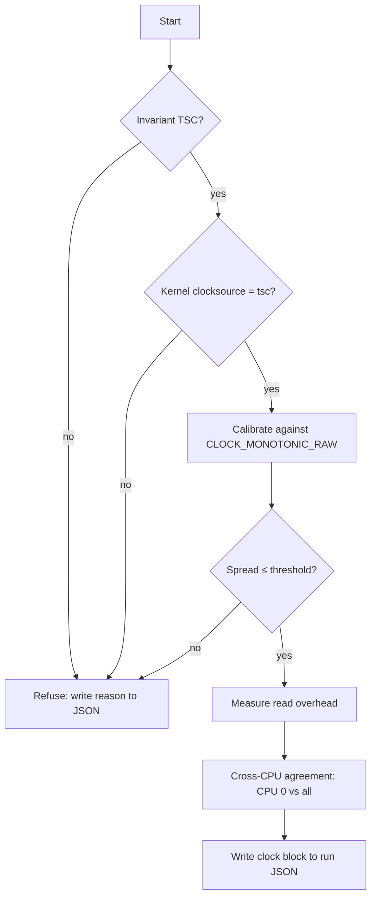

# 001 — Clock

**Status:** Agreed · **Updated:** 2026-10-18

## Proposal

Every latency figure in this repo is a difference between two clock reads. If the clock is wrong,
slow or disagrees between cores, every number built on it is wrong too, and nobody can tell. This
component makes the clock trustworthy and proves it in every run's output.

It does:

- read the TSC with correct ordering, with a start read and an end read;
- refuse to run unless the TSC is invariant and the kernel trusts it;
- calibrate ticks to nanoseconds against `CLOCK_MONOTONIC_RAW`;
- measure and publish its own overhead;
- measure and publish how far TSCs on different CPUs disagree.

It does not:

- provide wall-clock time, PTP or NIC hardware timestamps (depth tier);
- subtract its own overhead from results (overhead is published alongside instead);
- count core cycles (the TSC runs at a fixed rate whatever the core frequency; core cycles come
  from `perf` when needed);
- measure on ARM. It compiles there with a `std::chrono::steady_clock` fallback so the ARM
  correctness tests can build, and refuses to produce published measurements.

## Design

**Reads.** Raw ticks only on the hot path. Conversion to nanoseconds happens at report time.

| Read | Sequence | Why |
|---|---|---|
| `start()` | `lfence; rdtsc; lfence` | Earlier instructions finish before the read; later ones do not start before it |
| `stop()` | `rdtscp; lfence` | `rdtscp` waits for earlier instructions; the fence stops later ones moving above it |
| `stamp()` | `rdtsc` | For cross-thread timestamps carried in a message, where fences would distort the path being measured |

Intrinsics (`__rdtsc`, `__rdtscp`, `_mm_lfence`), no inline assembly.

**Startup checks.**

1. CPUID leaf `0x80000007`, EDX bit 8 (invariant TSC). Absent: refuse.
2. `/sys/devices/system/clocksource/clocksource0/current_clocksource` is `tsc`. Anything else
   means the kernel found the TSC unreliable: refuse.

**Calibration.** N windows (default 10) of about 100 ms each. In each window read
`CLOCK_MONOTONIC_RAW` and the TSC at both ends and compute ticks per ns. Publish the median and
the spread in ppm. Spread above a threshold (default 10 ppm): refuse.

**Overhead.** 1,000,000 back-to-back `start()`/`stop()` pairs, pinned, after warm-up. Publish
p50, p99, p99.9 and max, in ticks and ns. No dependency on the histogram component: a sorted
array is enough here.

**Cross-CPU agreement.** CPU A and CPU B ping-pong a cache line. A records `tA_send` before
writing; B records `tB_recv` on seeing it, then `tB_send` before replying; A records `tA_recv`.
If B's TSC is offset by θ from A's, then over many round trips

    θ ≤ d1 = min(tB_recv − tA_send)
    θ ≥ −d2 = −min(tA_recv − tB_send)

so θ lies in [−d2, d1]. A negative d1 or d2 is direct proof of disagreement. Run CPU 0 against
every other CPU, covering its hyper-thread sibling, the same socket and the other socket.

The interval's width, d1 + d2, is the fastest round trip: two one-way cache-line transfers. It
is a property of the interconnect, not of the clocks. Expect tens of ns on one socket and more
across the inter-socket link. The test can therefore prove disagreement (a negative bound), but
it can only show agreement to within that width. The output says so, so that a wide
cross-socket interval is not read as skew.

The reads must be fenced, or the bounds are wrong. An unfenced `rdtsc` can execute early or
late relative to the load or store around it. If B's receive read runs before its load has seen
A's write, or A's send read runs after its store has gone out, d1 shrinks and can go negative on
clocks that agree: a false proof of disagreement. So the send side uses `start()`
(`lfence; rdtsc; lfence`) before the store, and the receive side spins on the load, then
`lfence; rdtsc`. `stamp()` is not used here.

A is CPU 0. It takes housekeeping interrupts, but the bounds are minimums: an interrupted
round trip only produces a larger sample, which the minimum discards.

Each pair runs a fixed number of round trips (default 10,000). The minimum is also taken
separately over the first and second halves. If the second half's minimum is lower than the
first half's by more than one tick, the count was not enough to converge, and the pair is
marked `converged: false`.



**Output.** A `clock` block in each run's JSON:

```json
"clock": {
  "source": "rdtsc",
  "invariant_tsc": true,
  "kernel_clocksource": "tsc",
  "ticks_per_ns": 2.19999,
  "calibration_spread_ppm": 0.8,
  "overhead": { "p50_ns": 0, "p99_ns": 0, "p999_ns": 0, "max_ns": 0 },
  "cross_cpu": [ { "a": 0, "b": 44, "theta_lo_ns": 0, "theta_hi_ns": 0,
                  "round_trips": 10000, "converged": true } ]
}
```

Values shown are placeholders, not results.

## Spec

- S1. A run on a CPU without invariant TSC, or with a kernel clocksource other than `tsc`, exits
  non-zero and writes the reason. No results are produced.
- S2. Calibration spread above threshold exits non-zero.
- S3. Every run's JSON contains the `clock` block with all fields above.
- S4. Read overhead is published as p50/p99/p99.9/max, never as an average.
- S5. Cross-CPU bounds are published for CPU 0 against every other online CPU.
- S6. The hot path stores raw ticks only; no conversion or system call between `start()` and
  `stop()`.
- S7. The code compiles on ARM (`steady_clock` fallback), and the fallback refuses to produce
  published measurements.
- S8. Cross-CPU reads are fenced: the send read cannot move after the store, and the receive
  read cannot move before the load that observes the other CPU's write.

## Tasks

- [x] Header `include/lfipc/bench/clock.hpp`: `start()`, `stop()`, `stamp()`
- [x] Startup checks (CPUID, kernel clocksource)
- [x] Calibration
- [x] Overhead measurement
- [x] Cross-CPU agreement test
- [ ] JSON `clock` block
- [ ] Tests for S1–S8, including a forced-refusal test (S1, S2, S4, S7 done)
- [ ] First run on dev-lnx01 under `bench-on`; results reviewed here

## Review

| Date | Stage | Finding |
|---|---|---|
| 2026-10-18 | Draft | Written for review |
| 2026-10-18 | Agreed | Approved by Shep without changes |
| 2026-10-18 | Built (partial) | Calibration on dev-lnx01: 2.1974531 ticks/ns in three runs, spread 0.03–0.07 ppm. Nominal is 2.2 GHz; assuming it would be 0.12% off. Not yet a bench-on run |
| 2026-10-18 | Built (partial) | Cross-check: kernel refined calibration at boot reports 2197.453 MHz, matching ours to the kHz. Its first quick estimate (2197.632 MHz) was 81 ppm off |
| 2026-10-18 | Built (partial) | Overhead of a start()/stop() pair on dev-lnx01, CPU 2, not bench-on: p50 31–32 ns, p99 47 ns, p99.9 47 ns, max 17–24 µs. The max is about 500× the p50: interruptions, to be explained by the noise-floor meter |
| 2026-10-18 | Built (partial) | The percentile test caught a floating-point bug: 99.9 / 100 × 1000 rounds up past 999, so a bare ceil() reports the wrong rank in the tail. Fixed with p × n first and a guard |
| 2026-10-18 | Agreed | Cross-CPU section: interval width explained as the round-trip floor; reference CPU and round-trip count left as an open question |
| 2026-10-18 | Agreed | Open question settled with Shep: A stays CPU 0; 10,000 round trips per pair with a half-vs-half convergence check; fenced reads required (new S8) |
| 2026-10-18 | Built (partial) | Cross-CPU on dev-lnx01, not bench-on (schedutil; idle cores at 1.2 GHz): 87 pairs in 0.8 s, none proves disagreement. Widths: HT sibling (44) 51 ns, symmetric ±25.5; same socket 150–290 ns; other socket 290–390 ns. Only 21 of 87 converged: minimums fall with count (cross-socket d2 686 → 438 ticks from 10k to 1M round trips) and vary 20–60 ticks run to run. Cause is the target core's frequency ramping during a ~3 ms pair, not the interconnect; the convergence check flagged it as intended. Count and tolerance to be judged under bench-on |
